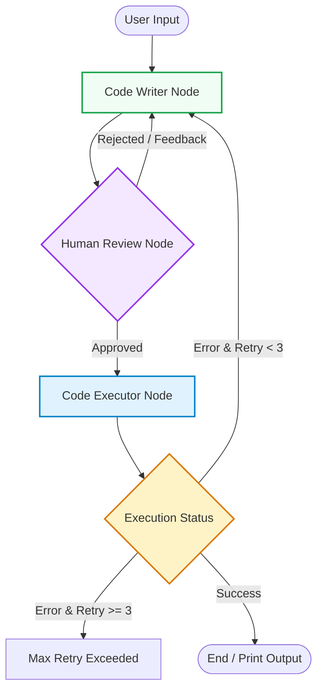

# 🧮 Secure Math Agent with LangGraph & RestrictedPython

An autonomous, secure, and interactive math assistant agent built using **LangGraph**, **Google Gemini (`gemini-3.1-flash-lite`)**, and a sandboxed execution environment powered by **RestrictedPython**. This agent can translate natural language math problems into executable Python code, verify its security, execute it safely, and automatically correct errors through a self-correction loop.

---

## ✨ Key Features

1. **Natural Language Math Solver**: Translates complex math queries (factorials, square roots, algebra, etc.) into precise Python scripts using LLM intelligence.
2. **Secure Sandboxing (`RestrictedPython`)**: Isolates code execution to prevent security vulnerabilities. It blocks unauthorized system imports while preloading the safe `math` module.
3. **Human-in-the-Loop (HITL)**: Uses LangGraph's `interrupt()` mechanism to pause execution, allowing human reviewers to inspect, approve, or reject code before it runs.
4. **Automated History Logging**: Automatically records approved code snippets along with timestamps into an `approved_codes_history.txt` file.
5. **Self-Correction & Reflection Loop**: If a syntax or runtime error occurs in the sandbox, the agent captures the error message, feeds it back, and automatically retries fixing the code up to 3 times.
6. **Session Persistence**: Powered by LangGraph's `MemorySaver` and thread configurations to maintain conversation state seamlessly.

---

## 🛠️ Tech Stack

* **Python** (3.10+)
* **LangGraph** (Workflow orchestration & Human-in-the-Loop)
* **LangChain & Google GenAI** (`gemini-3.1-flash-lite`)
* **RestrictedPython** (Secure code sandboxing)
* **Dotenv** (Environment variable management)

---

## 📂 Project Architecture

# Note: This is just a basic prototype...
